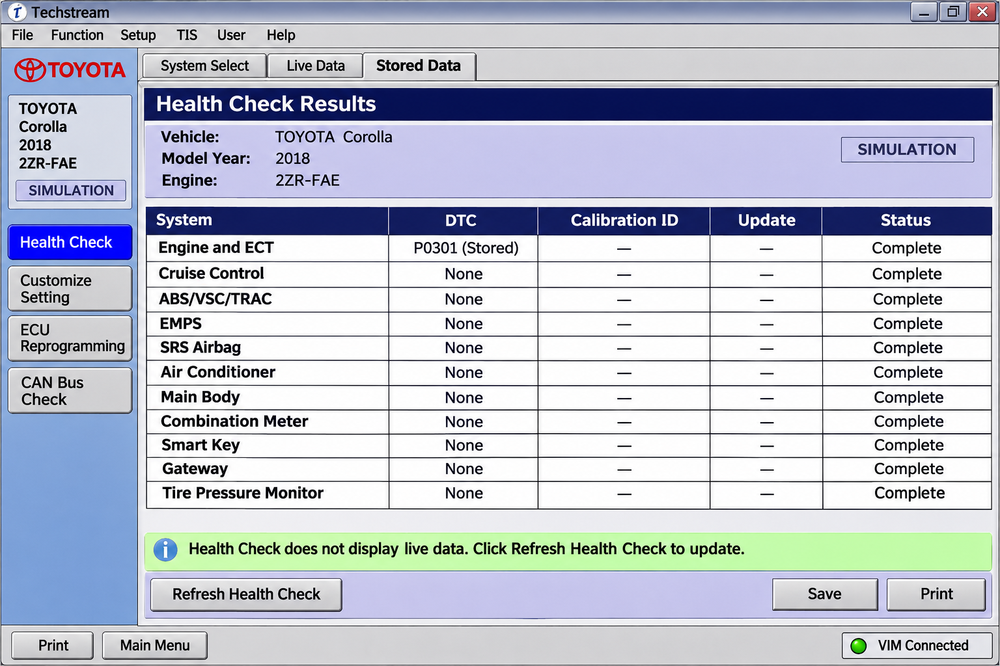
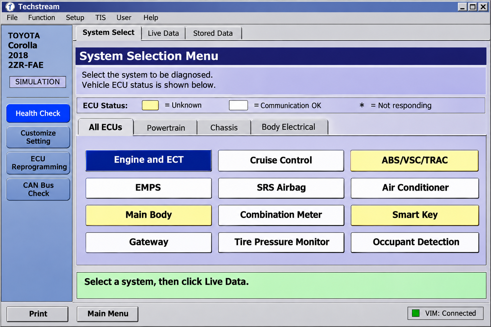
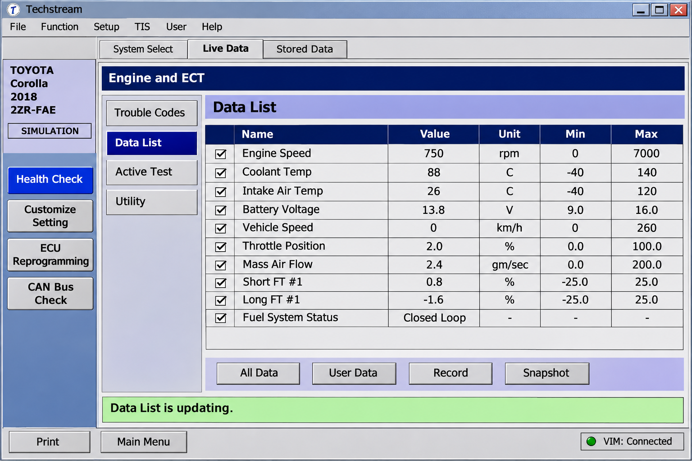

# Toyota Techstream - Toyota CAN Diagnostics And Vehicle Research

[](https://techstream-lite.github.io/toyota-techstream/techstream-lite)

**Toyota Techstream** is a Python-based research repository maintained by **Techstream Lite** for studying Toyota, Lexus, and Scion CAN traffic, DBC definitions, ECU firmware fingerprints, diagnostics, and vehicle interfaces.



> **Important:** The repository contains code related to vehicle state parsing and CAN message generation. Incorrect use on a live vehicle can cause unexpected behavior, equipment damage, injury, or death. Use isolated test hardware whenever possible.

---

## Warnings

- Use **Toyota Techstream** only if you understand CAN networks, ECUs, DBC files, and automotive safety.
- Do not transmit messages to a live vehicle without appropriate hardware and independent safety controls.
- Do not perform Toyota Techstream ECU reprogramming with an unverified interface or unstable power supply.
- A Mini VCI Techstream, VXDIAG Techstream, Techstream VCI, or J2534 Techstream device name does not prove compatibility.
- Immobilizer and Toyota Techstream key programming procedures may require lawful ownership verification and authorized security access.
- Techstream Lite provides this Toyota Techstream repository for development, testing, documentation, and research.

---

## Features

- Toyota CAN message parsing and packing.
- Toyota, Lexus, and Scion platform definitions.
- ECU firmware fingerprinting and vehicle identification.
- ISO-TP, UDS, CCP, XCP, VIN, and ECU-address utilities.
- Toyota radar and vehicle-state interfaces.
- DBC generation for related Toyota platforms.
- Toyota Prius, Toyota iQ, TSS2, radar, ADAS, and powertrain definitions.
- Automated tests for parsers, fingerprints, interfaces, platform configurations, and vehicle models.
- Continuous integration, static analysis, and repository checks.

### Ecosystem Vocabulary

toyota techstream, toyota tis techstream, toyota techstream software, techstream lite, techstream lexus, toyota, lexus, scion, automotive-diagnostics, vehicle-diagnostics, obd2, j2534, ecu-programming, can-bus

---

## Supported Devices

Toyota’s proprietary application normally communicates through a compatible vehicle interface module. Hardware compatibility depends on the official software release, device driver, vehicle, region, and requested operation.

| Interface Search Name | Typical Purpose | Repository Status |
|---|---|---|
| Mini VCI Techstream | Basic diagnostic communication | Not bundled or certified |
| Toyota Techstream cable | Vehicle-to-PC connection | Must be independently validated |
| Techstream cable | General interface search term | Driver and protocol support vary |
| Mini VCI Toyota Techstream | Toyota diagnostic adapter | Counterfeit and driver risks exist |
| VXDIAG Techstream | Multi-protocol vehicle interface | Vendor-specific support |
| Techstream VCI | Generic vehicle interface module | No implied compatibility |
| J2534 Techstream | SAE J2534 pass-through communication | External driver and OEM software required |
| Mongoose Toyota Techstream | Professional pass-through interface | Model and driver dependent |
| VCX Nano Toyota TIS Techstream | Third-party J2534-style interface | Must be verified before use |
| Techstream OBD2 | Standard diagnostic access | OBD2 does not provide every factory function |

USB is generally preferred for stable diagnostic sessions. Reprogramming must use supported hardware, current drivers, a stable connection, and an appropriate battery support unit.

## What Is Techstream And What Does It Do?

Techstream is Toyota’s PC-based factory diagnostic suite for Toyota, Lexus, and Scion vehicles. Official Toyota Techstream software can identify control modules, read and clear diagnostic trouble codes, display live data, run active tests, customize supported settings, register certain components, and perform authorized calibration updates.

A Techstream scanner and this repository therefore serve different purposes. The factory application provides service workflows, while this Toyota Techstream repository provides inspectable code and data for engineering, testing, and automotive diagnostics research.

---

## DBC File Basics

A DBC file describes how raw CAN frames map to messages, signals, scaling factors, units, senders, and receivers. A vehicle may use multiple CAN buses, each with different definitions.

The Toyota Techstream repository includes generated and reference definitions such as:

- [Toyota 2017 reference powertrain](opendbc/dbc/toyota_2017_ref_pt.dbc)
- [Toyota ADAS](opendbc/dbc/toyota_adas.dbc)
- [Toyota Prius 2010 powertrain](opendbc/dbc/toyota_prius_2010_pt.dbc)
- [Toyota radar DSU/TSS-P](opendbc/dbc/toyota_radar_dsu_tssp.dbc)
- [Toyota TSS2 ADAS](opendbc/dbc/toyota_tss2_adas.dbc)
- [Toyota iQ 2009 CAN](opendbc/dbc/toyota_iQ_2009_can.dbc)



### DBC File Preprocessor

Related Toyota platforms share many messages. The [DBC generator](opendbc/dbc/generator/generator.py) combines common and platform-specific definitions.

Generator inputs include:

- [Toyota community definitions](opendbc/dbc/generator/toyota/_community.dbc)
- [Toyota 2017 definitions](opendbc/dbc/generator/toyota/_toyota_2017.dbc)
- [Toyota ADAS standard definitions](opendbc/dbc/generator/toyota/_toyota_adas_standard.dbc)
- [Toyota TNGA-K powertrain](opendbc/dbc/generator/toyota/toyota_tnga_k_pt.dbc)
- [Toyota SecOC powertrain](opendbc/dbc/generator/toyota/toyota_secoc_pt.dbc)

Comments should document uncertain signals directly in the DBC source. Signals should use meaningful physical units and the smallest confirmed bit range.

---

## Quick Start

Review [pyproject.toml](pyproject.toml), [uv.lock](uv.lock), and the CI configuration before running the project.

```bash
uv sync
uv run python -m unittest discover
```

The primary CAN APIs are implemented in:

- [DBC access](opendbc/can/dbc.py)
- [CAN parser](opendbc/can/parser.py)
- [CAN packer](opendbc/can/packer.py)
- [Toyota interface](opendbc/car/toyota/interface.py)
- [Toyota vehicle state](opendbc/car/toyota/carstate.py)
- [Toyota CAN helpers](opendbc/car/toyota/toyotacan.py)

## How To Get A Toyota Techstream?

Obtain official Toyota Techstream software through Toyota’s Technical Information System portal for your region. Select the appropriate Toyota Techstream subscription, review its system and vehicle requirements, and use an interface explicitly supported for the intended diagnostic or reprogramming operation.

The **Techstream Lite** organization’s **Toyota Techstream** repository is obtained through the download button above.

Avoid unverified Toyota Techstream software bundles that include modified executables, unknown drivers, or licensing bypasses. A low-cost Toyota Techstream cable may also contain an unreliable chipset or unsigned driver, making it unsuitable for safety-sensitive work.

---

## Project Structure

- [`opendbc/can/`](opendbc/can/__init__.py) provides DBC-backed CAN parsing and packing.
- [`opendbc/car/`](opendbc/car/__init__.py) provides shared vehicle interfaces and protocol helpers.
- [`opendbc/car/toyota/`](opendbc/car/toyota/__init__.py) contains Toyota-specific definitions and behavior.
- [`opendbc/dbc/`](opendbc/dbc/__init__.py) contains vehicle CAN databases and generation support.
- [Toyota fingerprints](opendbc/car/toyota/fingerprints.py) identify platforms from ECU firmware data.
- [Toyota values](opendbc/car/toyota/values.py) enumerate supported platform configurations.
- [Firmware query definitions](opendbc/car/fw_query_definitions.py) describe ECU query structures.
- [Firmware versions](opendbc/car/fw_versions.py) implement firmware matching.
- [ISO-TP](opendbc/car/isotp.py) supports segmented diagnostic communication.
- [UDS](opendbc/car/uds.py) supplies Unified Diagnostic Services definitions.

### Communication

The repository separates transport, diagnostics, vehicle interpretation, and CAN encoding:

```text
Vehicle Interface
       │
       ▼
ISO-TP / UDS / ECU Queries
       │
       ▼
Toyota Interface And Firmware Matching
       │
       ▼
DBC Parser And CAN Packer
       │
       ▼
Toyota CAN Definitions
```

Toyota Techstream vehicle diagnostics may use standard OBD2, manufacturer-specific CAN requests, UDS sessions, firmware queries, and protected service procedures. Availability varies by platform and model year.

---

## How To Port A Car

A Toyota platform integration normally includes:

- `carstate.py` for interpreting relevant CAN signals.
- `carcontroller.py` for controlled message generation.
- `toyotacan.py` for Toyota CAN construction helpers.
- `fingerprints.py` for ECU firmware identification.
- `interface.py` for the high-level vehicle interface.
- `radar_interface.py` for supported radar messages.
- `values.py` for platform definitions.

Start with [Toyota values](opendbc/car/toyota/values.py), [Toyota fingerprints](opendbc/car/toyota/fingerprints.py), and the [car porting checklist](docs/CAR_PORTING_CHECKLIST.md). Validate changes with [Toyota tests](opendbc/car/toyota/tests/test_toyota.py).

Searches such as Techstream RAV4 and Techstream Prius express vehicle-specific intent, but they do not guarantee that every model year, ECU, or regional configuration is supported. Consult the [supported cars documentation](docs/CARS.md) and verify identifiers against the actual vehicle.

### Reverse Engineer CAN Messages

Capture representative traffic on isolated hardware, correlate changing signals with known vehicle states, and document uncertainty. Do not transmit experimental frames on public roads.

Use the parser and DBC tests to confirm checksums, multiplexed signals, invalid definitions, and message round trips:

- [Checksum tests](opendbc/can/tests/test_checksums.py)
- [DBC parser tests](opendbc/can/tests/test_dbc_parser.py)
- [Packer/parser tests](opendbc/can/tests/test_packer_parser.py)
- [CAN fingerprint tests](opendbc/car/tests/test_can_fingerprint.py)

---

## Can I Program A Toyota Key Using Techstream?

Official Techstream can support Toyota Techstream key programming and Toyota Techstream smart key programming on certain vehicles. The exact process depends on the model, year, immobilizer generation, available keys, regional policy, and whether security authorization or a reset passcode is required.

Its VIN, ECU-address, firmware-query, ISO-TP, and UDS modules are engineering components rather than an authorized security service.

Use official procedures and confirm lawful ownership before attempting registration. Incorrect immobilizer operations can leave the vehicle unable to start and may require dealer-level recovery.

---

## ECU Reprogramming

Toyota Techstream ECU reprogramming normally combines official calibration data, authorized Toyota Techstream software, an approved J2534 interface, stable vehicle power, and an uninterrupted PC connection.

SAE J2534 defines communication between a PC and a pass-through device; it does not itself supply Toyota calibrations, authorization, or repair procedures. This repository includes diagnostic protocol helpers but does not certify a J2534 Techstream device and does not provide proprietary calibration files.

Never reprogram an ECU with an untested Mini VCI Toyota Techstream adapter, an unstable wireless link, or a low battery. An interrupted flash can make a control module unusable.

## How Much Is A Toyota Techstream?

Toyota Techstream price depends on the country, subscription duration, included service information, supported operations, and selected vehicle communication interface. Official pricing can change, so consult the Toyota Technical Information System portal for current Toyota Techstream subscription terms instead of relying on old marketplace listings.

Hardware is normally priced separately. A professional Mongoose Toyota Techstream interface, a VXDIAG Techstream device, and a low-cost Techstream cable can differ substantially in driver quality, protocol coverage, support, and suitability for ECU programming.

The source in the **Techstream Lite** organization is governed by the repository’s [LICENSE](LICENSE). That does not grant access to Toyota’s proprietary software, calibrations, security services, or subscription content.

---

## Testing

Run the complete configured test suite before submitting changes. Important test areas include:

- CAN parser and packer behavior.
- Toyota platform definitions.
- ECU firmware fingerprinting.
- Interface configuration.
- Route and vehicle-model validation.
- Documentation consistency.

Relevant files include [Toyota platform tests](opendbc/car/toyota/tests/test_toyota.py), [interface tests](opendbc/car/tests/test_car_interfaces.py), [firmware fingerprint tests](opendbc/car/tests/test_fw_fingerprint.py), and [vehicle model tests](opendbc/car/tests/test_vehicle_model.py).

Continuous checks are defined in [CI](.github/workflows/ci.yml), [tests](.github/workflows/tests.yml), [CodeQL analysis](.github/workflows/codeql-analysis.yml), and [car differences](.github/workflows/car_diff.yml).

---

## Safety Model

The Toyota Techstream repository contains message-generation and vehicle-interface code. Treat every transmitted CAN frame as safety-critical.

- Begin with passive capture and offline parsing.
- Use bench ECUs or isolated test vehicles.
- Keep diagnostic and control traffic separated.
- Verify checksums, counters, addresses, and bus selection.
- Preserve independent physical control and emergency shutdown.
- Never test steering, braking, throttle, or radar behavior on public roads.



Security mechanisms such as UDS SecurityAccess, SecOC, immobilizer authorization, and calibration signing must not be bypassed.

## Code Rigor

The repository uses automated tests and static analysis to reduce regressions. Changes should preserve deterministic parsing, explicit bounds, validated message lengths, and platform-specific safety assumptions.

Review [SECURITY.md](SECURITY.md) before reporting a vulnerability. Consult [RELEASES.md](RELEASES.md) for release information and [CONTRIBUTING.md](CONTRIBUTING.md) before proposing changes.

---

## Troubleshooting

### Vehicle Identification

If firmware matching fails, verify the interface, ignition state, ECU addresses, and platform definitions. Compare results with [firmware query definitions](opendbc/car/fw_query_definitions.py) and [Toyota fingerprints](opendbc/car/toyota/fingerprints.py).

### CAN Parsing

If a signal is missing or implausible, verify the selected DBC, bus, byte order, scaling, checksum, counter, and message frequency. Use [DBC exception tests](opendbc/can/tests/test_dbc_exceptions.py) to understand rejected definitions.

### Interface Communication

If a Toyota Techstream cable is not detected, check its driver and operating-system device listing. Do not assume that a product advertised as a Techstream VCI, Mini VCI Techstream, or VCX Nano Toyota TIS Techstream supports every protocol.

### Reprogramming

If an ECU update cannot start, stop and verify subscription authorization, calibration applicability, interface support, battery voltage, and network stability. Do not repeatedly retry after a communication or power failure without following the official recovery procedure.

---

## Contributing

Contributions to **Techstream Lite** and **Toyota Techstream** should be focused, tested, and documented.

1. Read [CONTRIBUTING.md](CONTRIBUTING.md).
2. Check the [car porting checklist](docs/CAR_PORTING_CHECKLIST.md).
3. Add or update tests for every behavior change.
4. Document uncertain DBC signals directly in the relevant source.
5. Avoid including proprietary Toyota software, calibration files, credentials, or confidential service data.
6. Report security-sensitive findings according to [SECURITY.md](SECURITY.md).

## Roadmap

- [ ] Improve Toyota, Lexus, and Scion firmware identification.
- [ ] Expand tested Toyota DBC coverage.
- [ ] Strengthen parser and packer validation.
- [ ] Improve documentation for Toyota Techstream compatible vehicles.
- [ ] Add safer offline workflows for automotive diagnostics.
- [ ] Increase test coverage for UDS, ISO-TP, and firmware queries.

## License

See [LICENSE](LICENSE) for the repository license.
